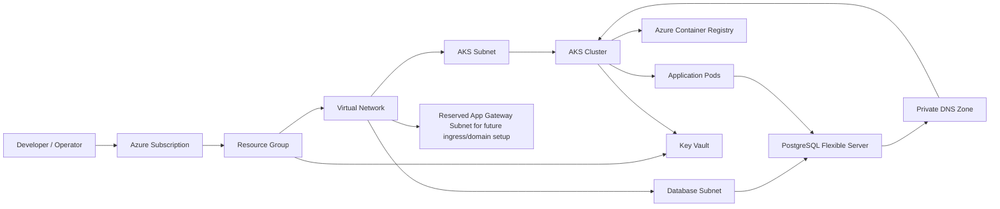

# Azure AKS Infrastructure

This project provisions a secure Azure Kubernetes Service (AKS) environment with networking, private PostgreSQL, Azure Container Registry (ACR), Key Vault, and private DNS using Terraform.

It is designed for a private, VNet-integrated three-tier application setup where the AKS cluster, database, and supporting services communicate over Azure private networking rather than public endpoints.

## Architecture overview

The platform includes:

- Azure Resource Group
- Virtual Network with dedicated subnets for AKS and database workloads
- AKS cluster with managed identity and kubelet identity
- Azure Container Registry for application image storage
- PostgreSQL Flexible Server in a private subnet
- Private DNS zone for PostgreSQL name resolution
- Azure Key Vault for secrets and configuration
- A reserved application gateway subnet kept ready for future domain and ingress integration (not currently provisioned as an app gateway resource)



## Current Terraform configuration

This repository is configured to deploy the following environment based on the values in `terraform.tfvars`:

```hcl
subscription_id = "cec54560-6b89-4061-8be3-036610dd4326"
resource_group_name = "learning-vijay-rg"
location = "westus"
environment = "dev"

vnet_name = "learning-vijay-vnet"
vnet_address_space = "10.0.0.0/16"
aks_subnet_prefix = "10.0.1.0/24"
database_subnet_prefix = "10.0.2.0/24"
appgw_subnet_prefix = "10.0.4.0/24"

aks_cluster_name = "learning-vijay-aks"
aks_dns_prefix = "learning-vijay-aks"
aks_node_count = 2
aks_vm_size = "Standard_D2s_v7"

acr_name = "learningvijayacr"
key_vault_name = "kvlearningvijaydev"

postgres_sku_name = "B_Standard_B2s"
postgres_version = "16"
postgres_storage_mb = 32768
postgres_db_name = "appdb"
postgres_server_name = "learning-vijay-dev-psql"
```

## Project structure

```text
.
├── main.tf
├── providers.tf
├── variables.tf
├── terraform.tfvars
├── README.md
├── usefull-commands.sh
├── modules/
│   ├── aks/
│   ├── acr/
│   ├── database/
│   ├── dns/
│   ├── keyvault/
│   ├── networking/
│   └── compute/
├── .gitignore
└── .terraform/   # generated locally by Terraform, ignored by git
```

## Prerequisites

Before you start, ensure you have:

- Azure CLI installed and authenticated
- Terraform installed locally
- Access to an Azure subscription with permission to create resource groups, networking, AKS, PostgreSQL, ACR, and Key Vault resources
- A supported Azure region for the selected VM SKU and services

### Sign in to Azure

```bash
az login
az account set --subscription "<subscription-id-or-name>"
```

You can confirm the active subscription with:

```bash
az account show -o table
```

## Getting started

### 1. Clone the repository and enter the folder

```bash
git clone <your-repository-url>
cd azure-aks-infra
```

### 2. Sign in to Azure from your local machine

```bash
az login
az account set --subscription "<subscription-id-or-name>"
```

This is required before running Terraform from your local machine so Azure CLI can authenticate and authorize resource creation.

### 3. Review the configuration values

Open `terraform.tfvars` and update the values to match your Azure subscription, naming convention, and region.

If you are using a different environment or custom app name, update:

- `resource_group_name`
- `location`
- `aks_cluster_name`
- `acr_name`
- `key_vault_name`
- `postgres_server_name`
- `postgres_db_name`

### 4. Initialize Terraform

```bash
terraform init
```

### 5. Validate the configuration

```bash
terraform validate
```

### 6. Review the planned deployment

```bash
terraform plan
```

This step shows every Azure resource that will be created before you apply changes.

### 7. Provision the infrastructure

```bash
terraform apply --auto-approve
```

This will create the following resources:

- Resource group
- Virtual network and subnets
- Reserved application gateway subnet for future ingress/domain integration
- Private DNS zone for PostgreSQL
- PostgreSQL Flexible Server
- AKS cluster
- ACR registry
- Key Vault
- Role assignments and managed identities

### 8. Get cluster access

After deployment completes, fetch the cluster credentials:

```bash
az aks get-credentials \
  --resource-group <resource-group-name> \
  --name <aks-cluster-name> \
  --overwrite-existing
```

Then test access:

```bash
kubectl get nodes
kubectl get pods -A
```

### 9. Deploy application workloads

Once the cluster is up, you can push a container image to ACR and deploy workloads using Kubernetes manifests or Helm.

Example image push pattern:

```bash
az acr login --name <acr-name>
```

Then build and push your application image to ACR and deploy it to AKS.

## Terraform workflow summary

```bash
terraform init
terraform validate
terraform plan
terraform apply --auto-approve
```

To remove all created resources:

```bash
terraform destroy --auto-approve
```

## Azure resource details

### AKS module

The AKS cluster is provisioned with:

- managed identity for cluster operations
- kubelet identity for pulling ACR images
- network configuration using the AKS subnet
- a node pool sized to `Standard_D2s_v7` in the current configuration

### Database module

The PostgreSQL Flexible Server is created as a private service using:

- `public_network_access_enabled = false`
- delegated database subnet integration
- private DNS zone linkage for internal name resolution
- generated administrator password
- a dedicated server name variable: `postgres_server_name`

The server name currently resolves to:

```hcl
learning-vijay-dev-psql
```

### Key Vault and ACR

The project sets up:

- Azure Container Registry for image storage
- Key Vault for secure secret and identity-related configuration
- AKS identity access for pulling images and using assigned permissions
- An application gateway subnet reserved for future domain and ingress integration, such as NGINX Ingress or Azure Application Gateway

## Accessing PostgreSQL from AKS

Because PostgreSQL is private, applications inside the AKS cluster connect using the private hostname and network integration rather than a public endpoint.

Typical connection pattern:

```bash
psql "host=<private-db-fqdn> user=psqladmin password=<password> dbname=appdb sslmode=require"
```

In Kubernetes, the application should use the private database service endpoint or FQDN created by the PostgreSQL Flexible Server and the private DNS zone integration.

## Important operational notes

- Use a region that supports the selected VM SKU and service availability for your Azure subscription.
- Some Azure subscriptions may not allow all regions or all VM sizes, so confirm availability before applying.
- Licensing, quota restrictions, and subscription limits can affect whether the deployment succeeds.
- A private PostgreSQL configuration requires correct subnet delegation and private DNS configuration for name resolution to work reliably from AKS.
- Since the database is private, avoid public access unless you explicitly need it for troubleshooting or external access.

## Useful commands

Authenticate and select the right subscription:

```bash
az login
az account set --subscription "<subscription-id>"
```

Check Azure regions and availability:

```bash
az account list-locations -o table
az vm list-skus --location westus --resource-type virtualMachines -o table
```

Check cluster health:

```bash
kubectl get nodes
kubectl get pods -A
kubectl get svc -A
```

## Notes

- This project is designed for a secure Azure environment with private endpoints and internal-only access patterns.
- The values in `terraform.tfvars` are the current deployment defaults for this repository.
- The application gateway subnet is intentionally kept as a future-ready network space for domain and ingress integration; it is not currently used by an Application Gateway resource.
- For production use, consider externalizing credentials and secrets via secure secret management and CI/CD pipelines.

## License

This project is intended for infrastructure learning, experimentation, and Azure deployment practice.
